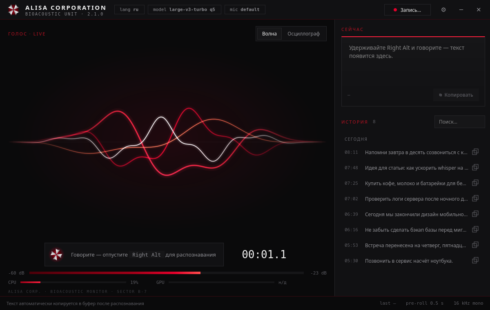
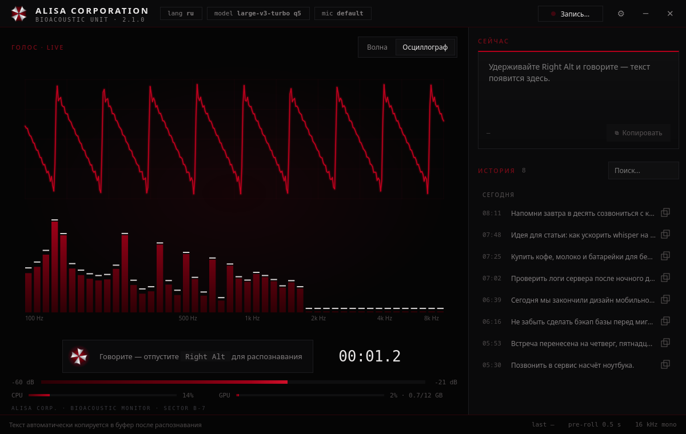
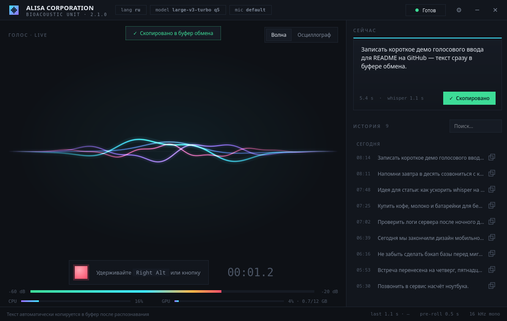
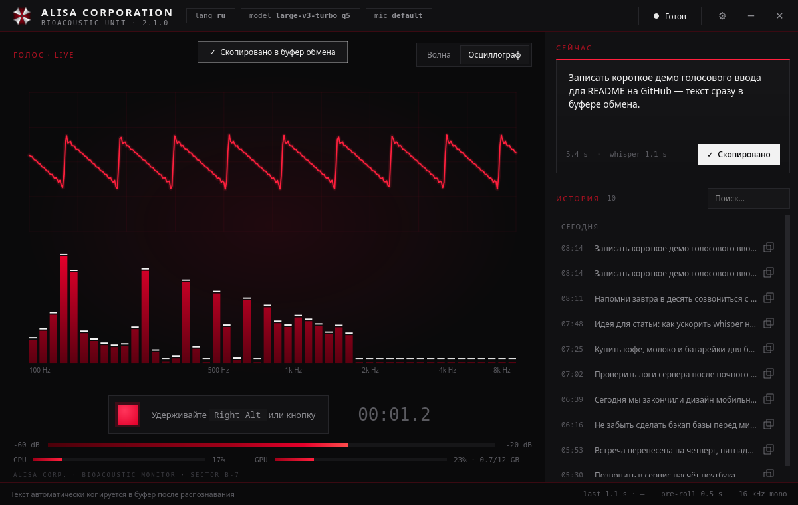
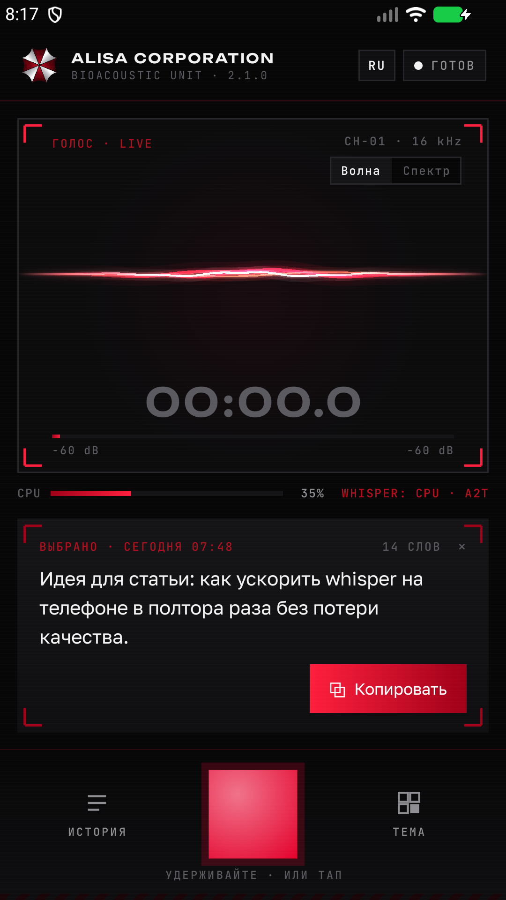
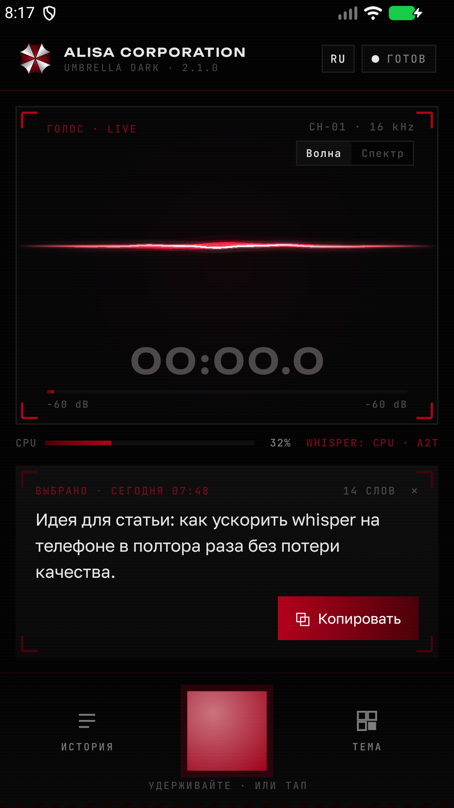
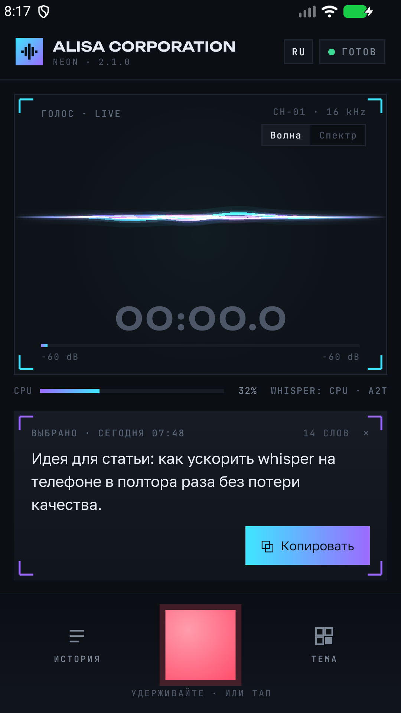
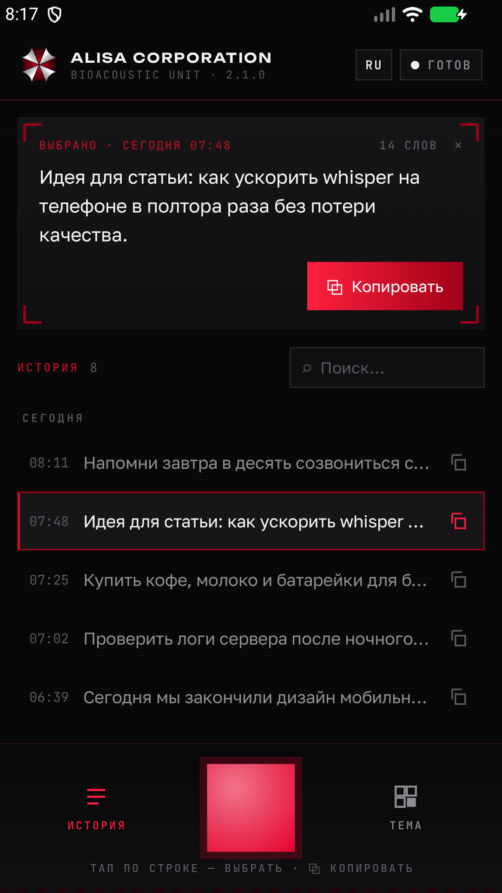

# ALISA CORPORATION · VOICIFY

**Bioacoustic unit 2.1.0** — local push-to-talk speech-to-text on whisper.cpp: hold a key, speak, and the text
lands in your clipboard (and, optionally, straight in the active window). Desktop GUI (PySide6) and an Android app
(Jetpack Compose) share one look: three themes, live voice visualisation and a searchable history. Nothing leaves
your machine.

## Gallery

### Desktop

| Umbrella · recording | Umbrella Dark · oscilloscope + spectrum |
|---|---|
|  |  |
| **Neon · result** | **Umbrella · result** |
|  |  |

### Android

| Umbrella | Umbrella Dark | Neon | History |
|---|---|---|---|
|  |  |  |  |

<sub>Screenshots use demo data.</sub>

The underlying engine is a Python script that enables push-to-talk functionality using whisper.cpp for real-time speech transcription and automatic clipboard copying.

## Features

- **Push-to-Talk**: Hold a key (default: spacebar) to record audio
- **Real-time Transcription**: Uses whisper.cpp for fast, local speech recognition
- **Automatic Clipboard**: Transcribed text is automatically copied to your clipboard
- **Cross-platform**: Works on Linux, macOS, and Windows
- **Configurable**: Customizable key bindings, audio devices, and model paths

## Prerequisites

### 1. Install whisper.cpp

First, you need to have whisper.cpp installed and built. Follow the [whisper.cpp installation guide](https://github.com/ggerganov/whisper.cpp):

```bash
# Clone whisper.cpp
git clone https://github.com/ggerganov/whisper.cpp.git
cd whisper.cpp

# Build the project
make

# Install the CLI (optional, but recommended)
sudo make install
```

### 2. Download a Whisper Model

Download a pre-trained model from the whisper.cpp repository:

```bash
# For English (recommended for English users)
./download-ggml-model.sh base

# For multilingual support
./download-ggml-model.sh base multilingual

# For better quality (slower)
./download-ggml-model.sh small

# For best quality (slowest)
./download-ggml-model.sh medium
```

Models will be downloaded to `models/` directory by default.

### 3. Install Python Dependencies

The script uses a virtual environment to avoid system package conflicts:

```bash
# Option 1: Use the launcher script (recommended)
./run_push_to_talk.sh

# Option 2: Manual setup
python3 -m venv venv
source venv/bin/activate
pip install -r requirements.txt
```

## Usage

### Basic Usage

```bash
python push_to_talk.py
```

The script will:
1. Look for whisper.cpp CLI executable (default: `whisper-cli`)
2. Find a whisper model in common locations
3. Start listening for key presses
4. Hold LEFT ALT to record, release to transcribe
5. Automatically copy transcription to clipboard

### Advanced Usage

```bash
# Specify custom whisper.cpp path
python push_to_talk.py --whisper-path /path/to/whisper-cli

# Specify custom model path
python push_to_talk.py --model /path/to/model.ggml

# List available audio devices
python push_to_talk.py --list-devices

# Use specific audio device
python push_to_talk.py --audio-device 1
```

## Desktop GUI

`voice2clip_gui` is a PySide6 front-end for the same engine:

- live voice visualisation: neon sine waves or oscilloscope + FFT spectrum
- latest transcription card with a **Copy** button
- searchable history of all saved transcriptions, each row with its own copy button
- three themes: **Neon**, **Umbrella** (black / blood red) and **Umbrella Dark** (near-black / deep dried-blood red), switchable in the ⚙ menu
- auto-paste into the active window (Ctrl+Shift+V / Ctrl+V, via a virtual keyboard — works on Wayland)
- CPU / GPU load bars; automatic CPU fallback when the GPU runs out of memory
- settings (theme, auto-copy, notifications, always-on-top) are remembered via QSettings

```bash
./run_gui.sh          # first run creates .venv with PySide6 + numpy
```

Hold **Right Alt** (or the on-screen record button) to record, release to transcribe.
Set `VOICE2CLIP_CONFIG=/path/to/config.json` to use another config file.
Design mockups live in `design/`, gallery screenshots in `docs/screenshots/`.

## Android app

The Android version (Jetpack Compose, same design and themes) lives in the `voice2clip-android` branch of the
whisper.cpp fork, under `examples/whisper.android`:

- hold the button to talk, or tap once for hands-free and tap again to stop
- runs whisper on the phone's CPU (`-O3`, ARMv8.2 dot-product + fp16), only over the length of the phrase
  instead of a full 30 s window; a short post-roll keeps the last word when the button is released early
- finds `ggml-*.bin` models in *Downloads* (one-time "All files access") or via the file picker; prefers
  `ggml-large-v3-turbo-q4_0.bin` — about 1.5× faster than q5_0 on ARM with the same text
- history compatible with the desktop JSON format; thread count switch (auto / 4 / 6 / 8) for tuning
- no internet permission: audio and text never leave the phone

## Configuration

### Key Binding

By default, the script uses the LEFT ALT key as the push-to-talk key. To change this, modify the `push_to_talk_key` variable in the `PushToTalk` class initialization:

```python
self.push_to_talk_key = pynput.Key.alt_l  # Change to desired key
```

Available keys:
- `pynput.keyboard.Key.space` (default)
- `pynput.keyboard.Key.shift` (shift key)
- `pynput.keyboard.Key.ctrl` (control key)
- `pynput.keyboard.Key.alt` (alt key)
- `pynput.keyboard.Key.f1` through `pynput.keyboard.Key.f12` (function keys)

### Model Configuration

The script automatically searches for models in these locations:
- `~/.cache/whisper/`
- `./models/`
- `/usr/local/share/whisper/`
- `/usr/share/whisper/`

You can specify a custom model path using the `--model` parameter or by modifying the `model_path` parameter in the `PushToTalk` class.

### Audio Settings

Default audio settings:
- Sample Rate: 16,000 Hz
- Channels: Mono (1)
- Format: 16-bit PCM
- Chunk Size: 1,024 frames

## Troubleshooting

### "whisper.cpp not found" Error

1. Ensure whisper.cpp is installed: `which whisper-cli`
2. If not installed, run `sudo make install` in the whisper.cpp directory
3. Or specify the path: `python push_to_talk.py --whisper-path /full/path/to/whisper-cli`

### "Model not found" Error

1. Download a model: `./download-ggml-model.sh base`
2. Check if model exists: `ls models/`
3. Specify model path: `python push_to_talk.py --model /path/to/model.ggml`

### Audio Device Issues

1. List available devices: `python push_to_talk.py --list-devices`
2. Try different devices: `python push_to_talk.py --audio-device 1`

### Permission Errors

On Linux, you might need to add your user to the `audio` group:

```bash
sudo usermod -a -G audio $USER
```

Then log out and log back in.

## Performance Tips

1. **Use appropriate model size**:
   - `base`: Fast, good for real-time use
   - `small`: Better accuracy, still reasonably fast
   - `medium`: High accuracy, slower processing
   - `large`: Best accuracy, very slow

2. **Adjust thread count**: Modify the `--split-on-word` parameter in the `_transcribe_audio` method for better performance

3. **Close unnecessary applications**: This reduces CPU load and improves transcription speed

## System Requirements

- **OS**: Linux, macOS, or Windows
- **Python**: 3.6 or higher
- **RAM**: 1GB+ recommended
- **CPU**: Multi-core processor recommended for best performance

## License

This script is provided as-is for educational and personal use. Please refer to whisper.cpp's license for the underlying speech recognition technology.

## Contributing

Feel free to submit issues, feature requests, or improvements!

## Alternative Solutions

If this doesn't work for your setup, consider:
- [Vosk](https://alphacephei.com/vosk/) - Offline speech recognition
- [SpeechRecognition](https://pypi.org/project/SpeechRecognition/) - Python wrapper for various speech recognition services
- [Dragonfly](https://dragonfly2.readthedocs.io/) - Advanced speech recognition framework